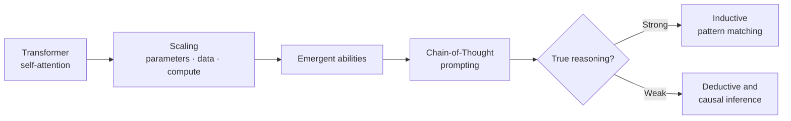

# 🧠 Emergent Reasoning in Large Language Models

  
  
  

  <b>Research paper</b> · Instituto Tecnológico de Morelia (TecNM) · <a href="./InvestigaciónInteligenciaArtificial.pdf">Read the full paper (PDF, in Spanish)</a>

---

## ⚡ Core Question

> **Do large language models truly reason, or do they simulate reasoning through statistical pattern recognition?**

This repository explores one of the most important questions in modern AI.

---

## 📖 Overview

This research investigates how modern AI systems—specifically **Transformer-based Large Language Models (LLMs)**—have evolved from simple next-token predictors into systems capable of **complex reasoning behaviors**.

It covers:

* The architectural foundations of Transformers
* The role of scaling laws in emergent capabilities
* The impact of Chain-of-Thought prompting
* The limitations of current reasoning in AI
* The future: causal reasoning, multimodal AI, and neuro-symbolic systems

---

## 🧩 Key Insights

* 🧠 **Inductive vs Deductive Gap**
  LLMs excel at pattern recognition but struggle with strict logical inference.

* 📈 **Emergent Abilities**
  Scaling models leads to unexpected capabilities, resembling phase transitions.

* 🔗 **Chain-of-Thought ≠ True Reasoning**
  It scaffolds reasoning behavior, but does not guarantee internal logical consistency.

* ⚠️ **Reasoning is Still Shallow**
  Current models lack robust causal understanding and world modeling.

---

## ⚙️ Technical Concepts Covered

### 🔹 Transformer Architecture

* Self-Attention (Q, K, V)
* Parallel sequence processing
* Comparison with RNNs / LSTMs

### 🔹 Scaling Laws

* Kaplan et al. (2020)
* Compute vs parameters vs data trade-offs
* Emergence thresholds

### 🔹 Prompt Engineering

* Chain-of-Thought (CoT)
* Self-consistency techniques
* Reasoning performance improvements

### 🔹 Future Directions

* Causal reasoning
* Neuro-symbolic AI
* Multimodal intelligence

---

## 📊 Visual Intuition

  <em>The path the paper follows: from architecture and scale to the limits of current reasoning</em>

---

## 📄 Full Research Paper

📥 [Download PDF](./InvestigaciónInteligenciaArtificial.pdf) — written in Spanish as a final paper at the Instituto Tecnológico de Morelia (TecNM).

---

## 🚀 Why This Matters

Understanding reasoning in AI is critical for:

* Safer AI systems
* Reliable decision-making
* Progress toward AGI
* Bridging statistical learning with true intelligence

---

## 🧠 Author Perspective

This work is part of an early-stage exploration into **AI reasoning systems**, with the goal of moving beyond implementation into **deep understanding and future research directions**.

---

## 🔮 Future Work

* Implement reasoning-aware systems (RAG + CoT)
* Explore causal inference in LLMs
* Build hybrid neuro-symbolic prototypes
* Analyze failure cases in reasoning tasks

---

## 🤝 Contributions

This is an independent research project. Suggestions, critiques, and discussions are welcome.

---

## 👨‍💻 Author

**Heriberto Ganesha Cortés Valdez** · [LinkedIn](https://www.linkedin.com/in/heriberto-ganesha-cort%C3%A9s-valdez-28bbb72b7/) · [ganesha.dev@outlook.com](mailto:ganesha.dev@outlook.com)

## 📜 License

The paper is shared under the [Creative Commons Attribution 4.0 International License (CC BY 4.0)](LICENSE). You may share and adapt it as long as you give appropriate credit.

---

## ⭐ Final Thought

> *Scaling intelligence is not the same as understanding it.*

---

  Made with curiosity and obsession for Artificial Intelligence

